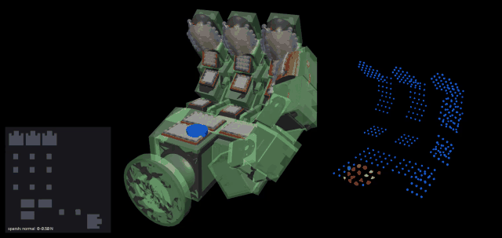
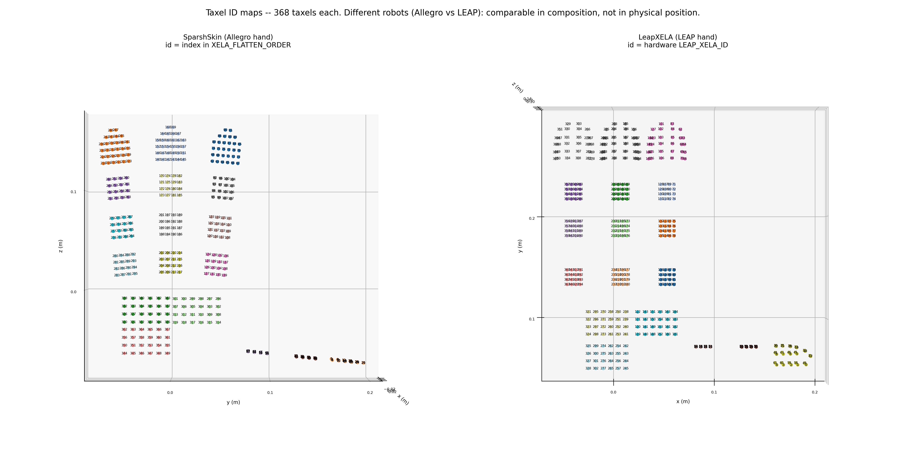

# LeapXELA: In-Hand Manipulation with Tactile Sensing

Simulation, data collection and hardware tooling for the **LEAP Hand** fitted with **XELA uSkin** magnetic tactile sensors (**368 taxels** across fingertips, phalanges and palm).

The repository has three parts:

1. **`leapxela/`**: a MuJoCo 3.11 simulator that builds a flex-membrane taxel skin onto the LEAP+XELA hand, runs grasp episodes on single- and multi-object scenes, and records per-taxel force in the same taxel order as the real hardware.
2. **`LeapXELA_Hardware_ws/`**: the real-robot workspace. It holds the Docker image (ROS 2 Humble), the XELA server configuration, CAN setup scripts and the ROS 2 packages for the LEAP hand, XELA sensors and teleoperation.
3. **`sim/`**: webcam teleoperation of the simulated hand. MediaPipe tracks hand landmarks and `dex-retargeting` maps them onto LEAP hand joints.

<p align="center">
  <a href="docs/media/demo_disk_squeeze.mp4">
    
  </a>
  <br>
  <em>A <code>disk</code> held on the palm under the <code>squeeze</code> grasp pattern. Left: the rendered hand with a 2D taxel heatmap inset. Right: the 368-taxel point cloud, coloured by SPARSH normal force (0 to 0.5 N).<br>
  Full-resolution video: <a href="docs/media/demo_disk_squeeze.mp4"><code>docs/media/demo_disk_squeeze.mp4</code></a></em>
</p>

---

## Contents

- [Repository layout](#repository-layout)
- [Simulation package (`leapxela`)](#simulation-package-leapxela)
  - [Features](#features)
  - [Taxel layout](#taxel-layout)
  - [Installation](#installation)
  - [Command-line tools](#command-line-tools)
  - [Quick start](#quick-start)
  - [Objects, grasp patterns and size limits](#objects-grasp-patterns-and-size-limits)
  - [Dataset collection presets](#dataset-collection-presets)
  - [Output format](#output-format)
  - [Module overview](#module-overview)
  - [Tests](#tests)
- [Hardware workspace (`LeapXELA_Hardware_ws`)](#hardware-workspace-leapxela_hardware_ws)
- [Webcam teleoperation in simulation (`sim`)](#webcam-teleoperation-in-simulation-sim)
- [Vendored third-party code](#vendored-third-party-code)
- [Credits and license](#credits-and-license)

---

## Repository layout

```
.
├── leapxela/                     # Installable Python package (simulation + dataset collection)
│   ├── configs/                  #   YAML presets for leapxela-collect
│   ├── mjcf/                     #   Base hand MJCF/URDF, joint config, meshes
│   ├── hardware/                 #   Calibration inputs copied from LeapXELA_Hardware_ws (taxel poses, ID map)
│   └── legacy/                   #   Abandoned sensor approaches (raycast, site-array, MJX), kept for reference
├── tests/                        # pytest suite; tests/sparsh_compare/ holds cross-env parity drivers
├── docs/                         # Design notes and demo media
│   ├── SPARSH_SENSOR_PARITY.md
│   ├── taxel_tip_pos.md
│   └── media/                    #   Demo video, GIF, taxel ID map
├── LeapXELA_Hardware_ws/         # Real-robot workspace: Docker, XELA server, CAN, ROS 2 packages
├── sim/                          # MediaPipe → dex-retargeting webcam teleop of the LEAP hand in MuJoCo
│   └── dex-urdf/                 #   git submodule (dexsuite/dex-urdf)
├── leapXELA_model-main/          # Vendored upstream LEAP+XELA MuJoCo model and early sensor generators
├── sparsh-multisensory-touch-main/  # Vendored Meta Sparsh / Sparsh-Skin code (dataset excluded)
├── pyproject.toml                # leapxela package metadata and pinned dependencies
├── environment-leapxela.yml      # Conda env for the leapxela simulator (MuJoCo 3.11)
├── environment.yml               # Conda env for sim/ teleop (MuJoCo 3.8, mediapipe, dex-retargeting)
└── requirements.txt              # pip equivalent of environment.yml
```

`data/` is created at run time for datasets and generated models. It is git-ignored because a full sweep is hundreds of GB.

---

## Simulation package (`leapxela`)

### Features

- **Flex-taxel hand generation.** Deformable flex skins are built onto the LEAP+XELA pad geometry with MuJoCo **3.11** `MjSpec`/flex, with pair contacts and adhesion.
- **Two tactile readouts.**
  - `contact`: MuJoCo contact wrenches binned to taxels.
  - `sparsh`: a port of the SPARSH Kelvin–Voigt membrane model, `f = K·u + B·v`.
  - `both`: the two readouts, time-aligned.
- **Hardware-compatible output.** The flat taxel order matches hardware taxel IDs `0..367`, so simulated tensors can be indexed exactly like real XELA streams.
- **Multi-object scenes.** Up to three objects are placed on the palm pads. Placement is per pad and checks coverage, so each object sits mostly over taxels.
- **Dataset sweeps.** Collection runs shape × count × grasp pattern in parallel workers. Strict acceptance rules make sure the object-count labels are unambiguous.
- **Rich artifacts.** Each episode writes an NPZ log (tactile data, kinematics, object poses), heatmaps, and an optional orbiting video with a live 3D taxel point cloud.

### Taxel layout

| Patch | Count | Composition |
|---|---|---|
| Fingertips | 4 × 30 | Index, middle, ring, thumb curved tips |
| Phalanges / knuckles | 11 × 16 | 4×4 pads (`uspa44`) |
| Palm | 3 × 24 | 4×6 pads (`uspa46`) |
| **Total** | **368** | |

<p align="center">
  
</p>

[`docs/taxel_tip_pos.md`](docs/taxel_tip_pos.md) shows how the 30 fingertip taxels lie on their curved module and how they map onto a 6×6 canvas.

### Installation

> **MuJoCo 3.11.0 is required, and the pin matters.** MuJoCo 3.11 moved flex elasticity into the CG constraint solver. Tactile numbers from this package are therefore not comparable to MuJoCo ≤ 3.10, or to the teleop environment in `sim/` (MuJoCo 3.8). Keep the two environments separate.

```bash
git clone --recurse-submodules https://github.com/pratik-ingle/leapXela-in-hand-manipulation.git
cd leapXela-in-hand-manipulation

# Creates the 'leapxela' env (Python 3.12) and installs the package in editable mode
conda env create -f environment-leapxela.yml

# Or, inside an existing Python ≥ 3.11 env:
pip install -e ".[leapxela]"        # mujoco==3.11.0, torch, pytorch-kinematics, einops, pyyaml
pip install -e ".[leapxela,dev]"    # + pytest, ruff
```

Always pass `--no-capture-output` to `conda run`, so MuJoCo's progress output streams to the terminal. Headless stepping and offscreen rendering work under plain `python`. The interactive viewer needs `mjpython` on macOS.

### Command-line tools

| Command | Module | Purpose |
|---|---|---|
| `leapxela-episode` | `leapxela.episode` | Run one grasp (single or multi-object); write NPZ, heatmaps and video |
| `leapxela-collect` | `leapxela.collect_flex_dataset` | Parallel shape × count × pattern dataset collection |
| `leapxela-build-hand` | `leapxela.hand_builder` | Generate flex skins (`--mode Box\|CoACD`) into `data/leapxela_generated/` |
| `leapxela-calibrate-sparsh` | `leapxela.calibrate_sparsh_sensor` | Measure the SPARSH noise floor and write QA thresholds as JSON |

Every tool takes `--help`. For `leapxela-collect`, settings are applied in the order **CLI > YAML > argparse defaults**.

### Quick start

```bash
# Render one episode like the demo above (single disk, squeeze pattern, SPARSH sensor)
leapxela-episode --objects disk --object-scale 0.5 --grasp-pattern squeeze --sensor-mode sparsh --seed 7

# Three mixed objects on the palm, holding the grasp, both sensors recorded
leapxela-episode --multi-count 3 --multi-shapes box disk T --grasp-pattern hold --sensor-mode both

# Smoke-test the dataset pipeline (tiny, no video)
conda run --no-capture-output -n leapxela leapxela-collect --config leapxela/configs/quick_smoke.yaml

# Full SPARSH sweep: 10 shapes × counts 1–3 × 6 patterns
leapxela-collect --config leapxela/configs/full_3obj.yaml
```

### Objects, grasp patterns and size limits

**Objects:** `box`, `cylinder`, `disk`, and the tetrominoes `I J L O S T Z`.

**Grasp patterns:** each runs after a 1.5 s closing phase.

| Pattern | Motion |
|---|---|
| `hold` | Close to the grip pose and hold steady |
| `pulse` | Sinusoidal grip modulation (default 1 Hz, ±0.15) |
| `squeeze` | Stepwise tightening (default 4 steps of 0.9 s) |
| `regrasp` | Slow full release toward the pre-grip pose and re-close (0.35 Hz) |
| `tap` | Fast partial release and re-close (1.5 Hz, half depth) |
| `shear` | Lateral abduction/roll oscillation that loads the skin tangentially |

**Maximum object scale** for each shape and object count. Larger objects cannot sit mostly over the palm pads, so the CLI rejects them. The values come from `SHAPE_MAX_SCALE` in `leapxela/episode.py`.

| Shape | 1 object | 2 objects | 3 objects |
|---|---|---|---|
| box | 0.75 | 0.70 | 0.50 |
| disk | 0.95 | 0.65 | 0.50 |
| cylinder | 0.40 | 0.40 | 0.30 |
| I | 0.60 | 0.60 | 0.60 |
| J | 0.95 | 0.85 | 0.55 |
| L | 0.90 | 0.75 | 0.55 |
| O | 1.00 | 1.00 | 0.75 |
| S | 1.00 | 0.90 | 0.65 |
| T | 0.95 | 0.85 | 0.70 |
| Z | 0.85 | 0.85 | 0.65 |

### Dataset collection presets

| Config | Intent |
|---|---|
| [`configs/quick_smoke.yaml`](leapxela/configs/quick_smoke.yaml) | Tiny contact run (1 box, 2 samples, 3 s) for sanity checks and CI |
| [`configs/contact_3obj.yaml`](leapxela/configs/contact_3obj.yaml) | box / disk / T × counts 1–3, `squeeze`, contact sensor |
| [`configs/sparsh_paired.yaml`](leapxela/configs/sparsh_paired.yaml) | Same shapes with `sensor_mode: both` (contact and SPARSH side by side) |
| [`configs/full_3obj.yaml`](leapxela/configs/full_3obj.yaml) | All 10 shapes × counts 1–3 × 6 patterns, SPARSH sensor |

### Output format

A sweep writes:

```
data/<output_root>/run_<YYYYMMDD_HHMMSS>/
├── dataset.json                      # run configuration and summary
├── index.csv                         # one row per accepted sample (shape, count, scale, pattern, peak force, …)
└── <shape>/count_<n>/<pattern>/sample_<k>/
    ├── sensor_log.npz
    ├── metadata.json                 # object specs, phases, grasp/sensor parameters, seed
    ├── hand_heatmap_{closed,peak,settled}.png
    ├── hand_heatmap_sparsh_{closed,peak,settled}.png
    └── grasp.mp4                     # optional
```

Key arrays in `sensor_log.npz`. Shapes below are for a 10 s episode sampled at 100 Hz, so `T = 1000`.

| Key | Shape | Description |
|---|---|---|
| `tactile` | `(T, 368, 3)` | Primary sensor force per taxel (normal, shear-x, shear-y), in hardware taxel order |
| `tactile_sparsh` | `(T, 368, 3)` | SPARSH Kelvin–Voigt readout (when `sensor_mode` is `sparsh` or `both`) |
| `tactile_times` | `(T,)` | Sample timestamps in seconds |
| `taxel_positions`, `taxel_normals` | `(T, 368, 3)` | World-frame taxel surface positions and normals |
| `hand_qpos`, `ctrl` | `(T, 16)` | Joint positions and actuator targets |
| `object_poses`, `object_vels` | `(T, N, 7)`, `(T, N, 6)` | Per-object pose (pos + quat) and velocity |
| `object_count`, `objects_held`, `objects_sensed` | scalar | Labels and acceptance diagnostics |
| `id_grid`, `skin_taxel_ids` | `(26, 31)`, `(368,)` | 2D canvas layout and per-skin taxel ID mapping |
| `sparsh_fk/*` | `(T, 368, …)` | Forward-kinematics-packed taxel positions, rotations and forces, in Sparsh-Skin format |

### Module overview

| Module | Role |
|---|---|
| `episode.py` | Grasp engine: scene build, object placement, control, sensing, artifacts |
| `collect_flex_dataset.py` / `collect_config.py` | Dataset sweep with worker pool, acceptance rules and YAML config |
| `hand_builder.py` | Generates the flex skins (`TAXEL_COUNT = 368`) |
| `sensors.py` | Sensor front-end: `contact` \| `sparsh` \| `both` |
| `flex_force.py` | SPARSH Kelvin–Voigt force core |
| `calibrate_sparsh_sensor.py` | SPARSH noise-floor calibration |
| `fk_taxel.py` | Hardware-order FK packing (`hand_ss.urdf` + pytorch-kinematics) |
| `taxel_layout.py` / `id_maps.py` | Canonical 368-taxel layout and ID maps from the hardware calibration |
| `grasp_patterns.py` / `action_trajectory.py` | Actuator schedules and offline NPZ trajectories |
| `visualizer.py` / `hand_map_svg.py` / `live_viewer.py` | Heatmaps, point-cloud video frames, SVG hand map, interactive viewer |

[`leapxela/mjcf/README.md`](leapxela/mjcf/README.md) lists which MJCF files feed the live pipeline.

### Tests

```bash
pytest                 # full suite
pytest -m "not slow"   # skip the end-to-end runs
```

The SPARSH parity tests skip cleanly when no local `sparsh-skin-sim` checkout is found (`--sparsh-sim-root`). The cross-environment drivers in `tests/sparsh_compare/` are run by hand and are not collected by pytest. [`docs/SPARSH_SENSOR_PARITY.md`](docs/SPARSH_SENSOR_PARITY.md) describes the bitwise parity of the force core and covers gain and `dt` calibration.

---

## Hardware workspace (`LeapXELA_Hardware_ws`)

Tooling for the physical LEAP hand with XELA uSkin sensors.

| Path | Contents |
|---|---|
| `docker/` | CUDA 12.2 + ROS 2 Humble image (`build.sh`, `create_container.sh`, `resume_container.sh`, …) |
| `etc_xela/` | XELA server configuration for the LEAP layout (`LEAP.xela`, `xServ_leap.ini`) |
| `shell/` | Download the XELA binaries, find the sensor USB devices, set up and reset CAN, run the XELA server and visualiser |
| `ros_ws/src/` | ROS 2 packages: `LEAP_Hand_API`, `xela_server_ros2`, `xela_data_collection`, `xela_description`, `xela_models`, `xela_point_cloud_representation`, `xela_telelop` (dex-retargeting teleop) |
| `leapXela_pointcloud/`, `leapXela_with_4_4_markers/` | Taxel-site extraction from the CAD model. These produce the calibration JSONs vendored into `leapxela/hardware/` |
| `mujoco_c_example/` | Minimal C++ MuJoCo loader and the `scene.xml` used by `sim/` |
| `realsene/` | RealSense viewer and depth + MediaPipe hand-tracking experiment |

Typical bring-up:

```bash
cd LeapXELA_Hardware_ws/docker
./build.sh && ./create_container.sh          # first time; then ./resume_container.sh

cd ../shell
./downlload_binaries.sh                      # XELA server binaries (linux_1.8.0)
./find_Xela_sensor_device_name.sh            # find the two USB-CAN adapters
./setup_can.sh /dev/ttyUSBx /dev/ttyUSBy     # bring up can0/can1
./run_xela_leap_visualization.sh             # XELA server + visualiser

cd ../ros_ws && colcon build && source install/setup.bash
ros2 launch xela_data_collection xela_server_and_client.launch.py
```

---

## Webcam teleoperation in simulation (`sim`)

This part drives the simulated LEAP hand from a webcam. MediaPipe's hand landmarker produces keypoints, `dex-retargeting` (vector retargeting) maps them onto joint targets, and the hand is shown in the MuJoCo viewer.

```bash
git submodule update --init sim/dex-urdf     # robot URDFs used by dex-retargeting
conda env create -f environment.yml          # MuJoCo 3.8, mediapipe, dex-retargeting, pinocchio
# or: pip install -r requirements.txt

mjpython sim/live_webcam_control.py          # live webcam teleop (python on Linux)
mjpython sim/leap_view.py                    # view the hand scene only
mjpython sim/static_retarget_test.py         # static retargeting sanity check
python  sim/tools/inspect_leapjoint_name.py  # print the MuJoCo actuator ↔ retargeting joint mapping
```

---

## Vendored third-party code

| Directory | Source | Notes |
|---|---|---|
| `leapXELA_model-main/` | LEAP+XELA MuJoCo model by Mohammad (Onshape export) | The live MJCF inputs are curated into `leapxela/mjcf/`; this copy is kept as a reference |
| `sparsh-multisensory-touch-main/` | [facebookresearch/sparsh](https://github.com/facebookresearch/sparsh): Sparsh-X / Sparsh-Skin tactile SSL | Reference for taxel packing and FK conventions; not a runtime dependency. **CC-BY-NC 4.0**, see its `LICENSE.md`. The `sparsh-skin-dataset/` and paper PDF are not committed |
| `sim/dex-urdf/` | [dexsuite/dex-urdf](https://github.com/dexsuite/dex-urdf) | git submodule |
| `LeapXELA_Hardware_ws/ros_ws/src/LEAP_Hand_API`, `xela_*` | LEAP Hand and XELA Robotics | Under their own licenses where included |

---

## Credits and license

- **Author:** Pratik Ingle
- **Base hand MJCF and meshes:** Mohammad (see [`leapxela/mjcf/README.md`](leapxela/mjcf/README.md))
- **SPARSH sensor model:** ported from Meta's Sparsh-Skin simulator. See [`docs/SPARSH_SENSOR_PARITY.md`](docs/SPARSH_SENSOR_PARITY.md)

The original code in this repository is released under the [MIT License](LICENSE). Vendored third-party directories keep their own licenses, as listed above.
